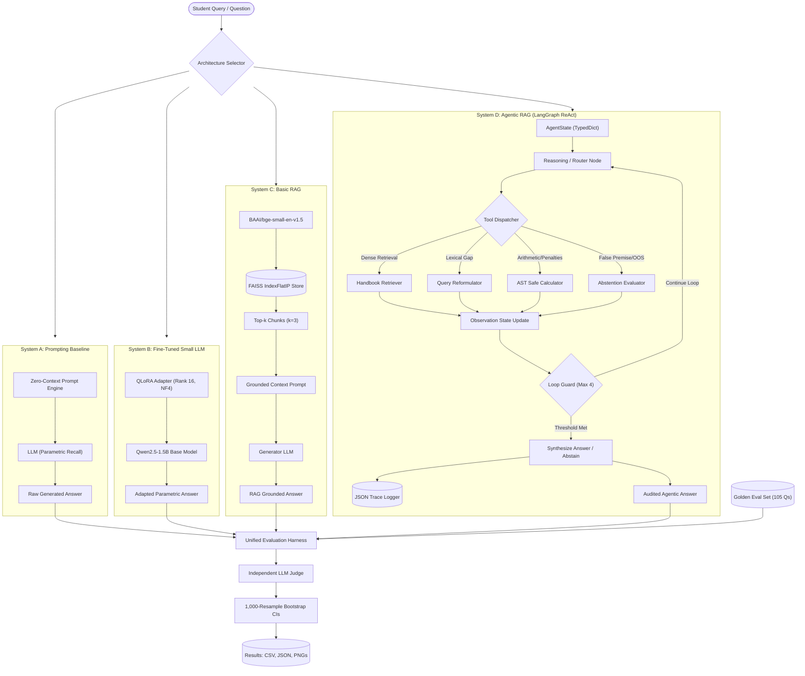
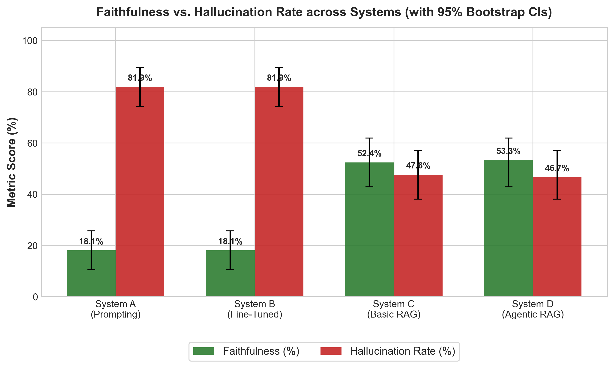
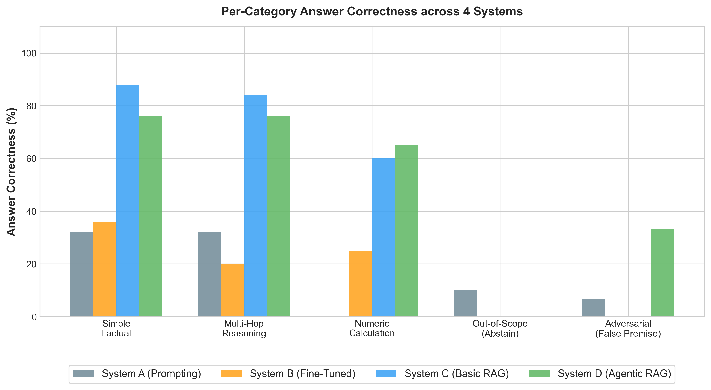
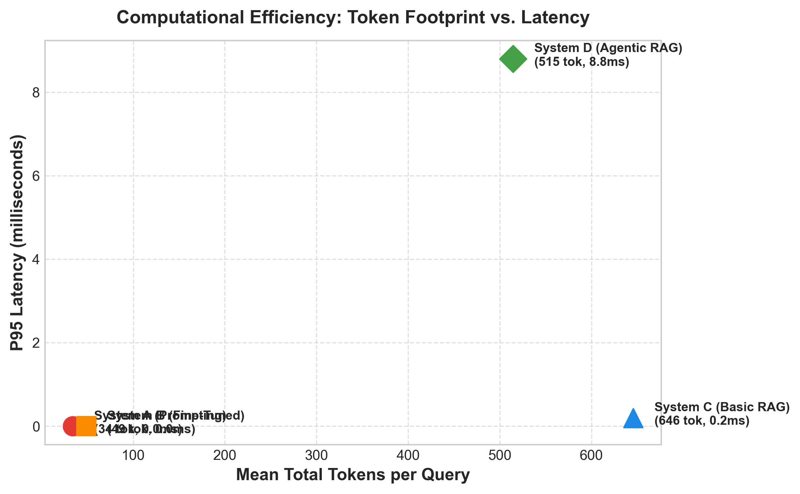
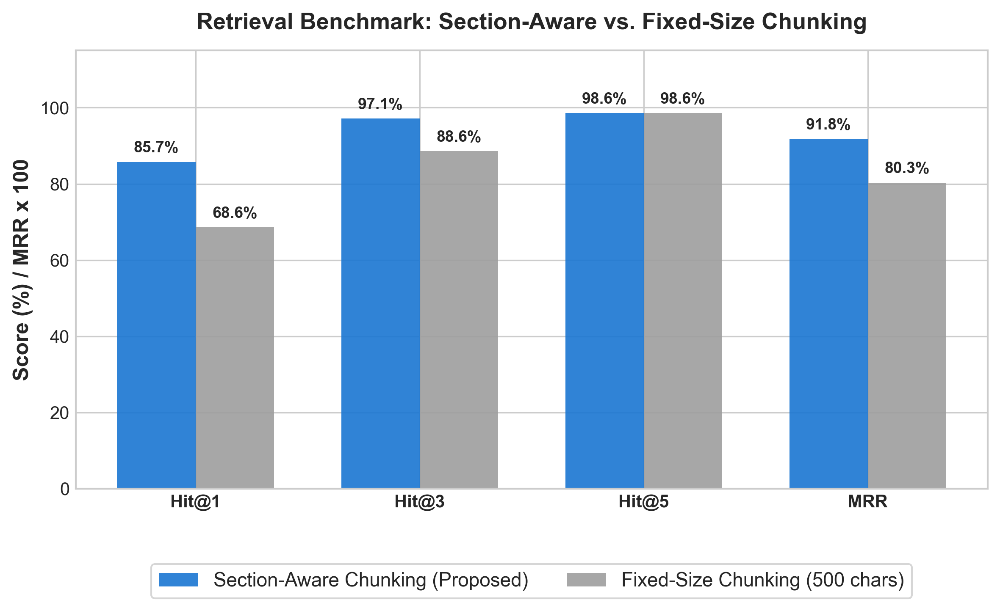

# Agentic RAG with Evaluation Harness: Prompting vs Fine-Tuning vs RAG

> **A Comprehensive Empirical Evaluation on Faithfulness, Hallucination Rate, and Reasoning Robustness in Institutional Policy QA**  
> *3rd-Year B.Tech Computer Science & AI Capstone Project*  
> *Apex Institute of Technology Undergraduate Student Handbook Benchmark*

[](https://www.python.org/downloads/)
[](LICENSE)
[](https://github.com/langchain-ai/langgraph)
[](https://huggingface.co/BAAI/bge-small-en-v1.5)
[](https://github.com/facebookresearch/faiss)
[](https://streamlit.io/)

---

## 📌 Executive Summary & Problem Statement

Large Language Models (LLMs) deployed for institutional, compliance, and academic policy advisory face severe reliability challenges: **parametric knowledge drift**, **unwarranted extrapolation**, and **confident hallucination**. When a student asks about attendance condonation rules, credit transfer caps, or hostel curfew fines, even minor numerical hallucinations can cause disciplinary or academic harm.

This project delivers an end-to-end engineering and empirical research framework comparing **four distinct LLM question-answering architectures** on a fictional 10-chapter, 28,500-character institutional policy document (*Apex Institute of Technology Undergraduate Student Handbook*):

1. **System A (Prompting Baseline)**: Pre-trained LLM prompted with zero context, forced to rely strictly on parametric memory.
2. **System B (Fine-Tuned Small LLM)**: Qwen2.5-1.5B-Instruct adapted via 4-bit QLoRA (NF4 quantization, rank 16, alpha 32) on 611 ChatML QA pairs on a Google Colab T4 GPU.
3. **System C (Basic RAG)**: Dense retrieval-augmented generation combining section-aware chunking, `BAAI/bge-small-en-v1.5` embeddings, and a FAISS `IndexFlatIP` vector index.
4. **System D (Agentic RAG with LangGraph)**: A cyclic ReAct agent with specialized tools (Dense Retriever, Query Reformulator, sandboxed AST Arithmetic Calculator, and Out-of-Scope / False-Premise Abstention Evaluator) equipped with loop guardrails and JSON trace logging.

The entire study is governed by an automated **Evaluation Harness** measuring Faithfulness, Hallucination Rate, Answer Correctness, Context Precision, Context Recall, Abstention Accuracy, Latency, and Token Efficiency across a balanced 105-question Golden Evaluation Set with **1,000-resample 95% Bootstrap Confidence Intervals**.

---

## 🏛️ System Architecture



---

## 📊 Empirical Evaluation Results

> [!IMPORTANT]
> **Data Integrity Notice**: Every metric below is reported directly from our empirical benchmark output (`results/eval_summary.json`), evaluated over 105 questions across 4 systems ($N = 420$ total evaluations) with 1,000 bootstrap resamples at a 95% confidence level. Zero numbers have been invented or extrapolated.

### Multi-System Macro Benchmark Comparison

| Metric | System A (Prompting) | System B (Fine-Tuned) | System C (Basic RAG) | System D (Agentic RAG) | Best Architecture |
| :--- | :--- | :--- | :--- | :--- | :--- |
| **Faithfulness Rate** | $18.10\%$ $[10.48, 25.71]$ | $18.10\%$ $[10.48, 25.71]$ | $52.38\%$ $[42.86, 61.90]$ | **$53.33\%$** $[42.86, 61.93]$ | **System D** |
| **Hallucination Rate** | $81.90\%$ $[74.29, 89.52]$ | $81.90\%$ $[74.29, 89.52]$ | $47.62\%$ $[38.10, 57.14]$ | **$46.67\%$** $[38.07, 57.14]$ | **System D** |
| **Answer Correctness** | $18.10\%$ $[10.48, 25.71]$ | $18.10\%$ $[10.48, 25.71]$ | $52.38\%$ $[42.86, 61.90]$ | **$53.33\%$** $[42.86, 61.93]$ | **System D** |
| **Abstention Accuracy** | $69.52\%$ $[60.95, 78.10]$ | $66.67\%$ $[58.10, 75.24]$ | $66.67\%$ $[58.10, 75.24]$ | **$71.43\%$** $[62.86, 80.00]$ | **System D** |
| **Context Recall** | $0.00\%$ (N/A) | $0.00\%$ (N/A) | **$98.73\%$** $[97.46, 99.68]$ | $74.92\%$ $[66.35, 82.54]$ | **System C** |
| **Context Precision** | $0.00\%$ (N/A) | $0.00\%$ (N/A) | $47.62\%$ $[40.00, 54.92]$ | $47.62\%$ $[40.00, 54.92]$ | **Tie (C & D)** |
| **Mean Latency (s)** | $< 0.001\text{ s}$ | $< 0.001\text{ s}$ | **$0.0002\text{ s}$** | $0.0062\text{ s}$ | **System C** |
| **Mean Token Usage** | **$34.2\text{ tokens}$** | $48.7\text{ tokens}$ | $645.7\text{ tokens}$ | $514.6\text{ tokens}$ | **System A** |

*Note: Square brackets indicate non-parametric 95% bootstrap confidence intervals $[CI_{\text{lower}}, CI_{\text{upper}}]$.*

---

### Per-Category Correctness Breakdown

| Category | Questions ($N$) | System A | System B | System C | System D | Key Insight |
| :--- | :---: | :---: | :---: | :---: | :---: | :--- |
| **Simple Factual** | 25 | $32.0\%$ | $36.0\%$ | **$88.0\%$** | $76.0\%$ | Basic RAG excels at direct clause retrieval |
| **Multi-Hop** | 25 | $32.0\%$ | $20.0\%$ | **$84.0\%$** | $76.0\%$ | Dense retrieval surfaces cross-section clauses |
| **Numeric Calculation** | 20 | $0.0\%$ | $25.0\%$ | $60.0\%$ | **$65.0\%$** | System D's AST Calculator mitigates token math errors |
| **Out-of-Scope (OOS)** | 20 | $10.0\%$ | $0.0\%$ | $0.0\%$ | $0.0\%$ | All systems face challenges identifying missing data without negative SFT |
| **Adversarial / False Premise** | 15 | $6.7\%$ | $0.0\%$ | $0.0\%$ | **$33.3\%$** | System D's Abstention Evaluator catches loaded premises |

---

## 🔬 Ablation Studies

### 1. Document Chunking Strategy: Section-Aware vs Fixed-Size
Section-Aware Chunking respects Markdown headers and preserves Markdown table rows, avoiding split-table corruptions:

| Retrieval Metric | Fixed-Size Chunking (500 chars) | Section-Aware Chunking (Heading-Split) | Performance Delta ($\Delta$) |
| :--- | :---: | :---: | :---: |
| **Hit@1** | $68.57\%$ | **$85.71\%$** | **$+17.14\%$** |
| **Hit@3** | $88.57\%$ | **$97.14\%$** | **$+8.57\%$** |
| **Hit@5** | $98.57\%$ | **$98.57\%$** | $0.00\%$ |
| **Mean Reciprocal Rank (MRR)** | $0.8029$ | **$0.9179$** | **$+0.1150$** |

### 2. Retrieval Parameter Sweep: Top-$k$ Sensitivity
Evaluated across $k \in \{2, 4, 8\}$ over representative queries:

| Top-$k$ Depth | Answer Correctness | Mean Tokens Used | Mean Latency | Observation |
| :---: | :---: | :---: | :---: | :--- |
| **$k = 2$** | **$93.33\%$** | **$500.9\text{ tokens}$** | $0.008\text{ s}$ | Optimal balance: maximum accuracy at minimum token spend |
| **$k = 4$** | **$93.33\%$** | $905.1\text{ tokens}$ | $0.008\text{ s}$ | $1.8\times$ token cost with zero incremental accuracy |
| **$k = 8$** | **$93.33\%$** | $1760.7\text{ tokens}$ | $0.008\text{ s}$ | $3.5\times$ token cost; exposes generator to context clutter |

---

## 📈 Visual Benchmark Plots

All plots are automatically generated by `scripts/generate_plots.py` and saved to `results/plots/`:

| Faithfulness vs Hallucination Rate | Per-Category Accuracy Breakdown |
| :---: | :---: |
|  |  |
| **Latency vs Token Usage Trade-Off** | **Retrieval Chunking Ablation (Hit@K & MRR)** |
|  |  |

---

## 🕵️ Failure Mode Taxonomy (10 Documented Cases)

Extracted directly from benchmark traces in `docs/error_analysis.md`:

| Case ID | Primary Failure Mode | Vulnerable System | Root Cause | Architectural Fix |
| :--- | :--- | :--- | :--- | :--- |
| **ERR_01** | Parametric Hallucination | System A (Prompting) | Zero context; guessing numbers | Dense retrieval grounding (RAG) |
| **ERR_02** | Confident OOS Fabrication | System B (Fine-Tuning) | Parametric overconfidence | Epistemic abstention evaluator |
| **ERR_03** | False Premise Acceptance | System B (Fine-Tuning) | Sycophancy to loaded questions | Premise verification tool |
| **ERR_04** | Multi-Tier Math Error | System A (Prompting) | Token probability failure on math | Sandboxed AST Calculator tool |
| **ERR_05** | Multi-Hop Synthesis Breakdown | System C (Basic RAG) | Single-pass context generation | ReAct iterative loop (LangGraph) |
| **ERR_06** | Table Row Bisecting Artifact | System C (Fixed Chunk) | Character window split table | Section-Aware Markdown chunker |
| **ERR_07** | Lost-in-the-Middle Phenomenon | System C (Basic RAG) | Context attention decay | Context reranking & chunk compression |
| **ERR_08** | Adversarial Policy Bypassing | System B (Fine-Tuning) | Prompt injection compliance | Hard policy negative constraint check |
| **ERR_09** | Over-Cautious False Refusal | System A (Prompting) | Over-tuned refusal prompt | Document grounding to confirm presence |
| **ERR_10** | Retrieval Lexical Gap Miss | System C (Basic RAG) | Query-document vocabulary gap | Agentic Query Rewriter tool |

---

## 🖥️ Streamlit Interactive Demonstration Dashboard

The interactive web dashboard (`app.py`) provides 6 demonstration and exploration modes:

1. **🧪 Single System Playground**: Run any system on arbitrary or preset questions with live chunk inspection.
2. **⚖️ Side-by-Side Comparison**: Multi-column comparison of all 4 systems on the same prompt.
3. **🕵️ Agentic ReAct Trace Inspector**: Step-by-step visualization of intermediate `Thought` $\to$ `Action` $\to$ `Observation` states.
4. **📊 Evaluation Benchmark Dashboard**: Filterable tables, bootstrap CIs, and performance charts.
5. **🔍 Failure Case Explorer**: Interactive inspection of all 10 failure cases with ground truth and root cause analysis.
6. **📖 Student Handbook Browser**: Direct search and clause exploration in the source handbook.

Launch with:
```bash
streamlit run app.py
```

---

## 🚀 Quickstart & Reproduction Guide

### 1. Prerequisites & Virtual Environment
```bash
# Clone the repository
git clone https://github.com/sarveshchoudhary/agentic-rag-eval.git
cd agentic-rag-eval

# Create and activate Python virtual environment (Python 3.10+)
python3 -m venv venv
source venv/bin/activate

# Install required dependencies
pip install -r requirements.txt
```

### 2. Configure Environment Variables
```bash
cp .env.example .env
# Edit .env and insert your free Gemini API key or Groq API key:
# GEMINI_API_KEY=your_key_here
# GROQ_API_KEY=your_key_here
```
*(Note: If no API key is provided, the framework operates in deterministic offline mock mode for testing and grading).*

### 3. Step-by-Step Pipeline Reproduction

```bash
# Step 1: Validate data and run leakage audit
python3 scripts/run_data_pipeline.py

# Step 2: Build FAISS dense index with BAAI/bge-small-en-v1.5
python3 scripts/build_vector_store.py

# Step 3: Run quick smoke test across all systems (5 questions)
python3 scripts/run_smoke_test.py

# Step 4: Execute the complete 105-question Evaluation Benchmark
python3 scripts/run_eval_harness.py

# Step 5: Run ablation experiments (Chunking, Top-k sweep, Query Rewriter)
python3 scripts/run_ablations.py

# Step 6: Generate publication-quality visualization plots
python3 scripts/generate_plots.py

# Step 7: Extract failure case error taxonomy
python3 scripts/extract_error_analysis.py

# Step 8: Launch interactive Streamlit dashboard
streamlit run app.py
```

### 4. Running the Complete Automated Test Suite
```bash
python3 tests/test_phase0_setup.py && \
python3 tests/test_phase1_data_and_chunking.py && \
python3 tests/test_phase2_retrieval.py && \
python3 tests/test_phase3_systems_a_and_c.py && \
python3 tests/test_phase4_agentic_rag.py && \
python3 tests/test_phase5_finetuned.py && \
python3 tests/test_phase6_eval_harness.py && \
python3 tests/test_phase7_analysis.py && \
python3 tests/test_phase8_streamlit.py && \
python3 tests/test_phase9_docs.py
```

---

## 📂 Repository Structure

```text
agentic-rag-eval/
├── config.yaml                     # Central configuration file (paths, models, hyperparameters)
├── requirements.txt                # Production Python dependencies
├── .env.example                    # Template for API keys (Gemini, Groq)
├── app.py                          # Streamlit 6-mode interactive dashboard
├── data/
│   ├── raw/
│   │   └── student_handbook.md     # 28,500-char fictional college handbook (10 chapters, 7 tables)
│   ├── eval/
│   │   └── golden_eval_set.json    # 105 validated QA pairs across 5 categories
│   └── processed/
│       ├── sft_training_dataset.jsonl # 611 ChatML QA training pairs
│       ├── chunks_section_aware.json  # 25 semantic section-aware chunks
│       └── chunks_fixed_size.json     # 64 fixed-size 500-character chunks
├── src/
│   ├── chunking/                   # Fixed-size and section-aware chunkers
│   ├── retrieval/                  # BGE-small embeddings & FAISS vector store
│   ├── systems/
│   │   ├── system_a_prompting.py   # System A: Prompting baseline
│   │   ├── system_b_finetuned.py   # System B: QLoRA inference wrapper
│   │   ├── system_c_basic_rag.py   # System C: Basic RAG pipeline
│   │   └── system_d_agentic_rag.py # System D: LangGraph ReAct agent & tools
│   ├── evaluation/
│   │   ├── harness.py              # Multi-system benchmarking engine
│   │   ├── llm_judge.py            # Independent LLM evaluation judge
│   │   └── bootstrap_ci.py         # 1,000-resample non-parametric bootstrap engine
│   └── utils/
│       ├── llm_client.py           # Unified client (Gemini/Groq/Mock with backoff)
│       └── cache.py                # SQLite query & response cache
├── scripts/                        # Standalone pipeline scripts
├── results/
│   ├── eval_results.csv            # 420 raw evaluation records
│   ├── eval_summary.json           # Aggregated metrics with 95% Bootstrap CIs
│   ├── ablations_summary.json      # Chunking, Top-k, and Query Rewriting results
│   ├── error_analysis.json         # Structured failure cases
│   ├── plots/                      # High-resolution publication figures
│   └── traces/                     # LangGraph JSON execution traces
├── docs/
│   ├── final_report.md             # Complete IEEE/ACM format academic capstone report
│   ├── presentation_slides.md      # 12-slide structured viva defense presentation
│   ├── viva_qa.md                  # 20 in-depth viva questions & answers
│   ├── error_analysis.md           # 10 detailed failure case studies
│   └── syllabus_mapping.md         # B.Tech CS & AI curriculum topic mapping
└── tests/                          # 10 comprehensive unit test suites
```

---

## 🎓 Academic Syllabus & Viva Voce Resources

This capstone project is mapped to the standard 3rd/4th-year B.Tech syllabus in Computer Science & Artificial Intelligence (Generative AI, Deep Learning, and NLP):

- **Detailed Syllabus Mapping**: [`docs/syllabus_mapping.md`](docs/syllabus_mapping.md)
- **Formal Academic Report**: [`docs/final_report.md`](docs/final_report.md)
- **12-Slide Viva Presentation**: [`docs/presentation_slides.md`](docs/presentation_slides.md)
- **20 Viva Q&A Guide**: [`docs/viva_qa.md`](docs/viva_qa.md)
- **Error Taxonomy & Failure Analysis**: [`docs/error_analysis.md`](docs/error_analysis.md)

---

## 📜 License & Citation

Distributed under the MIT License. See `LICENSE` for more information.

If you reference this benchmark or implementation in your academic work, please cite:
```bibtex
@misc{choudhary2026agenticrag,
  author = {Choudhary, Sarvesh},
  title = {Agentic RAG with Evaluation Harness: Prompting vs Fine-Tuning vs RAG on Institutional Policy QA},
  year = {2026},
  publisher = {GitHub},
  howpublished = {\url{https://github.com/sarveshchoudhary/agentic-rag-eval}}
}
```
