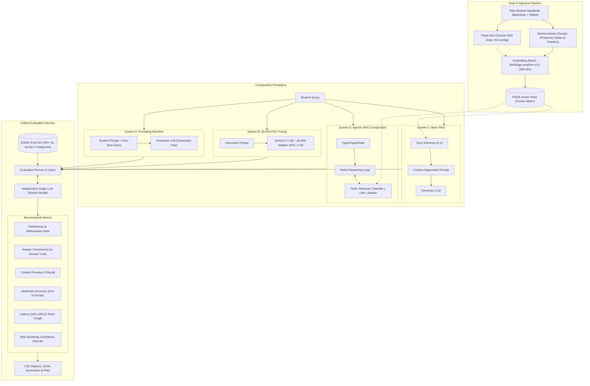
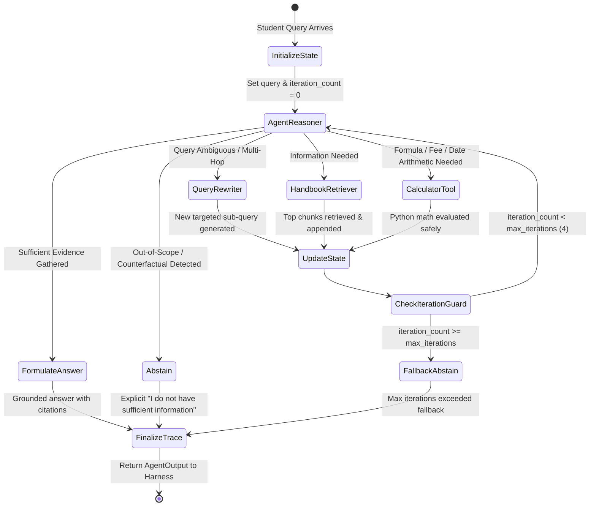
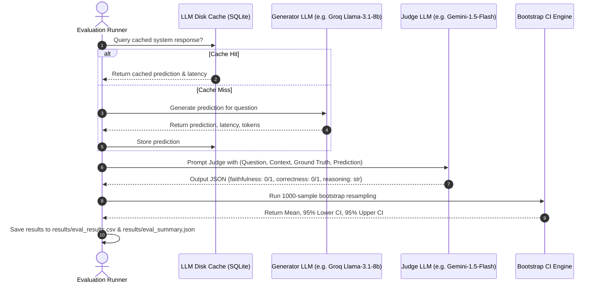

# System Architecture & Technical Specifications

This document outlines the architectural blueprints of the **Agentic RAG with Evaluation Harness** framework. It details the structural differences between Prompting, Fine-Tuning, Basic RAG, and Agentic RAG, along with the LangGraph state machine and evaluation harness workflows.

---

## 1. High-Level System Architecture

The following diagram illustrates how student queries flow into each of the four experimental paradigms, followed by standardized evaluation via the independent Judge LLM.



---

## 2. System D: Agentic RAG State Machine (LangGraph)

System D models reasoning as a cyclic state graph with deterministic tool execution and recursion guardrails:



### AgentState Typed Schema
```python
class AgentState(TypedDict):
    messages: list[dict[str, str]]
    original_query: str
    current_query: str
    retrieved_chunks: list[dict[str, Any]]
    tool_history: list[dict[str, Any]]
    iteration_count: int
    max_iterations: int
    is_abstaining: bool
    final_answer: str | None
    citations: list[str]
```

---

## 3. Evaluation Harness Pipeline

To prevent self-evaluation bias and ensure reproducible evaluation, generation and judging are decoupled:



---

## 4. Key Architectural Design Decisions

1. **Decoupled Generator & Judge**: Generator and Judge models must have distinct model weights and providers to prevent systemic self-confirmation bias.
2. **Deterministic Calculator Tool**: LLMs consistently struggle with multi-tier fee penalties and date differences. The ReAct agent delegates all arithmetic to a sandboxed Python execution tool.
3. **Explicit Abstention Gate**: Rather than forcing a hallucinated answer when a query lies outside the handbook, System D includes an explicit decision node to abstain gracefully.
4. **Transparent SQLite LLM Cache**: Prevents duplicate API calls during repeated metric runs, ensuring rate limits are preserved and latency measurements remain reproducible.

